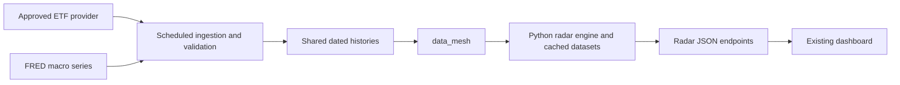

# Market-data requirements and data_mesh fit

Reviewed 2026-10-19 (Europe/Zurich). Evidence: radar commit `6b1e466d2e475addccbb7e7eed69f2a871f938ce`, local data_mesh 0.4.86 / `d19879f9c2a7a4eeea296f090fd4772c62566670`, data_forge `731fc373880e44a03f8f8d1a8a57b23062bc2f26`, source inspection, and read-only coverage queries against the connected MySQL databases. No provider purchases, paid market-data API requests, ingestion changes, or application changes were made.

## Decision

**Use data_mesh as the shared access layer. Its current stored coverage is insufficient to run this radar unchanged.** It already supports the relevant kinds of ETF history and FX retrieval, but this application's precise ETF universe needs onboarding and backfilling, and its FRED macro inputs need a shared ingestion/access interface.

The current application directly uses Twelve Data for ETF prices and FRED for macro series. These are implementation choices, not a requirement to retain Twelve Data. The contributor archive proposes Stooq but supplies neither the historical loader nor evidence of equivalent dividend/split treatment. A provider substitution must preserve a declared financial data contract.

## Minimum data needed for the implemented endpoints

The union is **16 ETF histories and 9 macro series**, at daily frequency. The current strategy rebalances monthly; no tick feed, order book, or intraday streaming infrastructure is needed for this implementation.

| Group | Required series | Use |
|---|---|---|
| Eleven US sector ETFs | XLB, XLC, XLE, XLF, XLI, XLK, XLP, XLRE, XLU, XLV, XLY | Sector returns, momentum, portfolio backtests |
| Benchmark | SPY | Benchmark and market signal |
| Other ETF proxies | QQQ, GLD, USO, UUP | Nasdaq, gold, oil, dollar exposure proxies in the live-data panel |
| Nominal Treasury yields | DGS2, DGS5, DGS10, DGS30 | Yield curve and rate factors |
| Real yield / inflation compensation | DFII10, T10YIE | Ten-year real yield and breakeven factors |
| Volatility | VIXCLS | Equity-volatility factor |
| Credit spread | BAMLH0A0HYM2 | US high-yield option-adjusted spread factor |
| Funding-rate reference | DFF | Daily effective federal funds rate used in financing assumptions |

Source: [market inputs](/Users/Nouyt/Apollo8/market-regime-radar/api/market.js:5), [sector universe](/Users/Nouyt/Apollo8/market-regime-radar/api/backtest.js:5), [macro requests](/Users/Nouyt/Apollo8/market-regime-radar/api/backtest.js:108).

Required semantics:

- Keep quoted closing prices separate from dividend-inclusive performance series. A total-return index is suitable for return calculations under its stated convention, but its index level is not an ETF's quoted USD price.
- For sector and benchmark performance, use consistent split/dividend-adjusted histories or an explicitly chosen total-return convention. Net-dividend and gross-dividend returns are different conventions; do not mix them across assets or providers.
- Preserve currency, units, exact instrument identity, observation date, availability time, source, acquisition time, and dataset version. GLD/USO/UUP are fund instruments; their economic exposure does not turn their prices into spot gold, spot oil, or an FX rate.
- The live-data endpoint currently requests 260 daily observations. Research needs longer histories, including the chosen normalization window and six-month momentum warm-up before the first evaluated return. The complete eleven-sector universe starts with XLC on 2018-06-19; do not manufacture pre-inception observations.
- Daily refresh after the relevant market close and macro publication windows is sufficient for the present model. Per-series freshness must follow its calendar and publication lag. Historical observation dates alone do not establish when a backtest could have known a value.

## What the connected stores actually contain

These are bounded coverage checks, not a complete valuation, gap, adjustment, or provider-entitlement audit. Dates are stored observation dates. Absence refers to the queried distribution routes and asset-master mappings, not every possible vendor or warehouse table.

| Checked route | Observed coverage on 2026-10-19 | Consequence |
|---|---|---|
| `bloomberg.ohlcv`, exact and prefix searches for the 16 requested ETF tickers | Only `GLD US Equity`: 5,512 rows from 2004-11-18 through 2026-10-16; close and net-dividend total-return fields non-null in all those rows | GLD has usable-looking stored coverage through the last completed US session; continuity and adjustment correctness still need validation |
| Same route, other 15 requested ETFs | No matching series found | Add/backfill the eleven sector funds, SPY, QQQ, USO, UUP, or populate an approved alternative source |
| `peculium.assets`, requested ticker IDs and Bloomberg ticker prefixes | No matching mappings found for this universe, including GLD | High-level identifier resolution needs onboarding even where a low-level price series exists |
| `bloomberg.indices` | SREAL, SWIIP, SWIIT; no requested US macro series | This table does not cover the radar's Treasury/inflation/credit requirements |
| Legacy `bloomberg.crypto` index fallback | `VIX Index` has 1,991 rows from 2017-10-18 through **2025-08-14** | A resolvable VIX identifier is not a current VIX feed; stale by more than a year |
| `yahoo_finance.fx_ohlc` | USD against AUD, CAD, CHF, EUR, GBP, JPY; latest stored dates 2026-10-16, except USD/EUR 2026-10-17 | Can support seven of the eight proposed FX-panel pairs through direct, inverse, and USD-cross conversion, after calendar alignment |
| Yahoo FX history and pair registry, CNH/CNY check | No CNH/CNY pair found | USDCNH is an additional acquisition requirement; do not substitute onshore CNY implicitly |

The six FX histories start between 2000 and 2006. They can produce EURUSD, USDJPY, USDCHF, GBPUSD, AUDUSD, USDCAD, and AUDJPY. The USD/EUR latest-date discrepancy versus its pair registry should be reconciled before publishing freshness.

No FRED/macro-series interface was found in data_mesh and no FRED ingestion domain was found in data_forge. The existing FMP database ingestion concerns company metadata; it should not be counted as an ETF-price warehouse. An old data_api FEDFUNDS CSV ends in November 2023 and is monthly, so it does not meet the current daily DFF requirement.

## Capabilities already available in data_mesh

| Capability | Existing behavior | Integration requirement |
|---|---|---|
| Stored Bloomberg history | `get_asset_close_local` / `get_assets_close_local` route to stored fields | Populate exact symbols and asset-master mappings; select the source explicitly |
| Bloomberg return history | `price_type='total_return'` selects `tot_return_index_net_dvds` | Adopt and document the net-dividend convention consistently |
| Bloomberg adjusted history | `price_type='adjusted'` selects stored `px_last` | The facade does not prove upstream dividend/split adjustment; verify ingestion semantics |
| FMP daily ETF prices | Explicit FMP source supports dividend-adjusted history for fund/equity instrument classes | A possible alternative, but live access, coverage, history completeness, and entitlement were not tested |
| FX | Stored direct/inverse and USD-cross paths | Align dates and preserve quote direction; extend coverage for CNH |
| Basket assembly | Defaults to forward filling; missing asset series can be omitted | Request `forward_fill=False`, assert the full expected universe, and reject unexplained gaps |
| Index fallback | Warns on stale legacy Bloomberg data but can return it | Add a publication gate; warning alone does not make a series current |

FMP's corporate-instrument `total_return` mode is deliberately unsupported; its adjusted-price endpoint is a separate contract. GLD, USO, and UUP must be routed as fund instruments, rather than generic commodity/FX exposure types, to select the appropriate adjustment endpoint. Keep optional provider-tail splicing disabled until observation-level provenance is explicit.

Evidence: [price mappings](/Users/Nouyt/Apollo8/data_mesh/data_mesh/fetch_data/_catalog.py:109), [FMP dispatch](/Users/Nouyt/Apollo8/data_mesh/data_mesh/fetch_data/_fmp_source.py:27), [basket behavior](/Users/Nouyt/Apollo8/data_mesh/data_mesh/fetch_data/_portfolio.py:291), [fund resolution](/Users/Nouyt/Apollo8/data_mesh/data_mesh/fetch_data/_funds.py:396).

## Recommended integration

1. Declare the 16-ETF / 9-macro registry with identifiers, fields, return convention, units, source, and freshness expectations. Reuse the existing Bloomberg pipeline for ETFs if it is the approved source, or validate the existing explicit FMP path. Retain FRED series identities for macro inputs unless any replacement is deliberately reconciled.
2. Add the missing histories and daily ingestion. Extend data_forge for macro ingestion and data_mesh for macro retrieval. Store publication/availability and revision metadata appropriate to the research contract, not just the latest observations.
3. Build one validated, versioned dataset per as-of date. All strategy variants should consume that same dataset. Fail clearly on missing required instruments, stale observations, or insufficient warm-up.
4. Consume data_mesh server-side. It is a private Python library plus CLI, not an existing generic HTTP data service, so the current JavaScript functions cannot simply point at a data_mesh URL. A Python radar backend is the natural shared-financial-logic boundary; a scheduled Python dataset export to the existing backend is a smaller transitional option.
5. Preserve the current frontend while replacing its provider calls and synthetic panels progressively. Existing backtest timing/accounting and UI defects remain separate remediation work.

The producer registry and existing readiness checks do not currently certify this radar's series: [registered domains](/Users/Nouyt/Apollo8/data_forge/src/lambda_function.py:94), [readiness scope](/Users/Nouyt/Apollo8/data_forge/src/lambda_function.py:214). The documented consumer boundary is [data_mesh architecture](/Users/Nouyt/Apollo8/cerebrum/03-Technology/Architecture/Repositories/data_mesh.md:14).

## Beyond the currently implemented endpoints

Making all displayed analytical panels real requires additional input definitions and calculations. The static volatility panel calls for VIX9D, VIX3M, VIX6M, VIX1Y, VVIX, SKEW, and MOVE. Fixed-income panels need additional real-yield/breakeven tenors and forward inflation measures. FX needs the eight pairs described above; cross-asset panels also need a specified copper instrument and consistent commodity proxies. Realized volatility, yield-curve slopes, correlations, and many ratios can be calculated from validated histories rather than purchased as separate feeds.

This is a second scope beyond replacing the feeds for today's live-data and backtest endpoints. If the dashboard will publish provider data outside Apollo, confirm that its display/redistribution use is covered by the applicable provider agreement; internal database access alone does not establish that permission.
