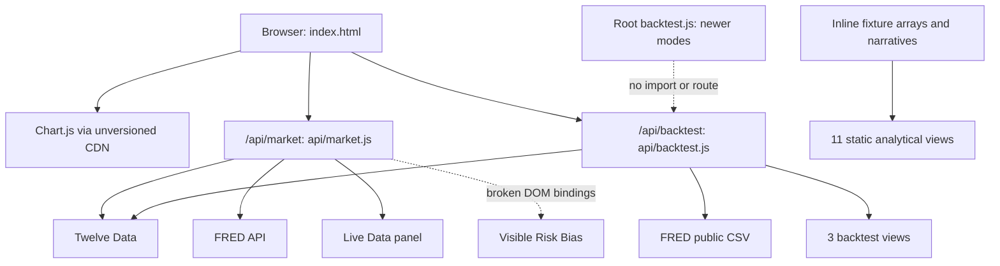

# Architecture and current capabilities

Reviewed 2026-10-19 (Europe/Zurich), commit `6b1e466d2e475addccbb7e7eed69f2a871f938ce`. This describes source behavior, not a verified production deployment.

## Purpose and implementation

Market Regime Radar is a US market monitoring and sector-rotation research dashboard. It combines macro/market narratives, sector preferences, and historical ETF portfolio comparisons. The frontend is plain HTML/CSS/JavaScript with Chart.js; two Vercel Node.js functions fetch Twelve Data and FRED. There is no database, queue, persistent research dataset, account system, or order execution path in the inspected application.

Nine files contain approximately 3,205 lines. The 1,972-line `index.html` contains about 61.5% of those lines: layout, styles, fixture data, financial heuristics, state, charts and API consumers. It contains four inline application scripts totaling 882 lines, 15 views, and 37 canvases. These counts indicate concentrated responsibilities; they are not themselves proof of bad performance.

## Runtime map

Vercel's documented convention serves supported files in the root `api/` directory. The repository's `vercel.json` configures those API paths. Root handlers are not connected to them by an import or rewrite. This is why newer root-file code does not establish working deployed features. [Vercel Node.js runtime](https://vercel.com/docs/functions/runtimes/node-js).

| File | Responsibility | Important observation |
|---|---|---|
| `index.html` | Entire UI, fixtures, heuristics, chart state and API calls | Multiple overlapping backtest runners; most views do not consume live data |
| `api/market.js` | Deployed market snapshot and correlation endpoint | Eight ETF histories and four Treasury series; date alignment/freshness defects |
| `api/backtest.js` | Deployed historical scoring and portfolio simulation | Older modes; financial accounting and calendar defects |
| `market.js` | Root handler copy | Byte-identical to deployed market handler, no demonstrated routed consumer |
| `backtest.js` | Newer root historical handler | Implements compare and leveraged long-only on a shared dataset; not imported by API |
| `engine-spec.json` | Intended methodology/capabilities | Valid JSON, but unconsumed and internally inconsistent |
| `package.json` | ESM, Node >=20, dev command | No declared packages or test/build/check commands |
| `vercel.json` | Function ceilings | Market 30 seconds; backtest 60 seconds |
| `README.md` | V4–V4.26 feature history | Current setup and capability statements conflict |

There are no import cycles because there is essentially no shared module graph. The important coupling is implicit DOM IDs, global/lexical script state, duplicated handlers and financial rules. Extracting clear ownership matters more than introducing a framework.

## Actual view inventory

| View | Current behavior |
|---|---|
| Overview | Fixed scores, narrative, anomalies and correlations; visible Risk Bias stays NEUTRAL 50% because the renderer addresses missing nodes |
| Sector Allocation | Fixed sectorModel, contribution and style arrays; one demo note exists |
| Backtest | Calls deployed historical API; startup/manual chart owners conflict; ranked mode labels do not match main results |
| Long Only Backtest | Requests longonly3; deployed handler returns ordinary ranked results, while UI labels 210% leverage |
| Strategy Compare | Requests compare; deployed payload lacks the required nested results |
| Rotation History | Fixture holdings, rolling alpha, drawdowns, robustness matrix and cost sensitivity; returned real holdings are unused |
| Regime Playbook | Fixed current regime, styles, FAVOR/AVOID and scenario narrative |
| Live Data | Provider-backed when both required keys are present; DEMO/DEMO_FALLBACK otherwise; currently no reliable observation-date freshness contract |
| What changed today? | Literal changes and normalized-change chart |
| Anomaly Engine | Literal anomalies; sorting works, history selector does not |
| Correlations | Literal matrix and sine-generated correlation history |
| Fixed Income | Literal nominal/real/breakeven and curve history/narrative |
| Volatility | Literal IV/RV, term structure, classification and narrative; one demo note exists |
| FX Regime | Literal FX matrix, cross-asset links, scores and narrative; no FX ingestion |
| History Match | Fixed 93.2% match and twelve historical analogues; no matching engine |

Thus **11 of 15 views are wholly static/fixture-backed**, one is market-feed-backed, and three request historical data but contain the mode/runner defects. A page-wide LIVE badge does not establish that the other panels are current.

## Data and model flow

The market function requests SPY, QQQ, XLF, XLK, XLE, GLD, USO and UUP daily histories plus FRED DGS2/DGS5/DGS10/DGS30. These are ETF proxies and Treasury series, not a comprehensive live multi-asset feed. It computes changes, return z-scores/percentiles and short-window correlations. The current correlation joins and freshness interpretation are defective.

The backtest requests eleven sector ETFs plus SPY, using `adjust=all`, and seven FRED histories: DGS2, DGS10, DFII10, T10YIE, VIXCLS, BAMLH0A0HYM2 and DFF. It reduces observations to monthly maps; standardizes macro states over preceding history; combines fixed sector exposures with six-month momentum; ranks sectors; applies portfolio weights, fees, financing and borrow; and calculates compounded equity and statistics. It needs historical normalization and momentum warm-up. Its full universe cannot predate XLC's 2018-06-19 inception.

This is a deterministic heuristic model, not an estimated latent-regime or calibrated probability model. The source does not establish out-of-sample efficacy. Detailed issues and a research design are in [business-context.md](business-context.md).

## Configuration contract as currently implemented

| Endpoint | Required configuration | Missing/failing-data behavior |
|---|---|---|
| `/api/market` | TWELVE_DATA_API_KEY **and FRED_API_KEY** | Missing keys: demo; provider failure: labeled demo fallback, currently cacheable |
| `/api/backtest` | TWELVE_DATA_API_KEY; FRED uses public CSV | Missing key: 503; required fetch failure: non-success response; internal data gaps can still be silently skipped |

The newest README claim that a FRED key is unnecessary applies to the backtest path, not the deployed market path.

## Focused architecture direction

1. Keep the simple UI/serverless shape while making status and results truthful.
2. Give provider normalization, financial scoring/accounting, HTTP validation and rendering explicit owners.
3. Make one authoritative engine reachable from the actual API path; test its response with the UI.
4. Separate one immutable result/run state from current controls and render all dependent views from it.
5. Share a dated provider dataset across strategy variations; preserve source, units, dates and calculation version.
6. Adopt the canonical Python financial boundary when aligning the model for shared production use, with parity/reference tests. Avoid an unrelated UI rewrite.

Root duplicate entry points should be checked for local consumers before removal. The review found no deployed import, not proof that no person has ever invoked them.
